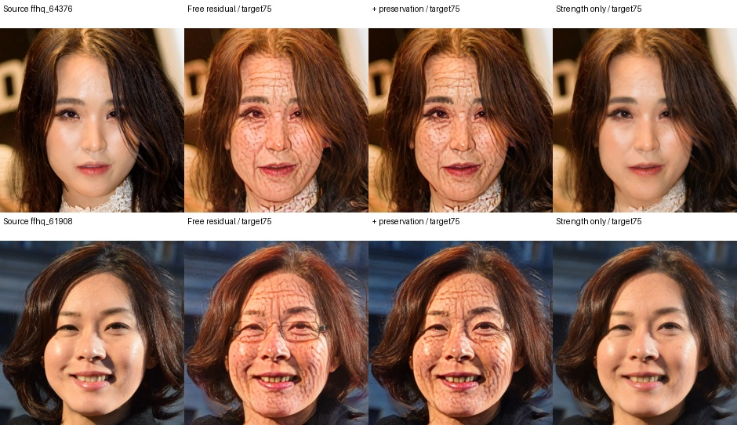
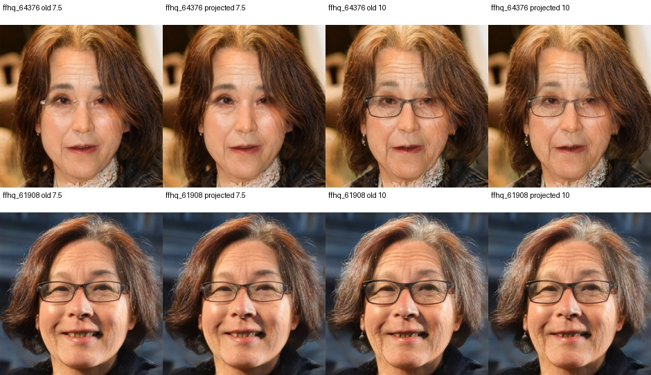

# SFE 条件训练、眼镜解耦与高龄年轻化诊断

2026-11-28，研究分支 `dev/mobei-gan-portable-20261116`。本轮围绕用户观察到的“无端加眼镜、高龄源图缺少自然中青年阶段”实际完成训练和机制对照，沿用 StyleGAN2／GAN 技术路线。**目前没有得到可晋升的通用年龄编辑模型。自由特征修正容易产生估龄模型喜欢、肉眼不自然的纹路；只学习强度能保住画质，但年龄控制改善很小。官方眼镜边界投影有个例收益，强编辑仍会加眼镜。**

这不是再次训练旧 SAM 编码器。使用官方 SFE 反演器、e4e、特征编辑器和 StyleGAN2 作为冻结底座，真实训练四份小适配器；默认 SAM 权重、上传推理和旧对照均保留。

## 看完整结果

电脑保持以下隧道运行：

```powershell
ssh -N -o ExitOnForwardFailure=yes -o UpdateHostKeys=no -L 127.0.0.1:16512:127.0.0.1:65512 yicloud
```

- [高龄年轻化密集扫描](http://localhost:16512/age-sfe-dense-review/)：三张高龄源图，SFE／e4e 同方向对照。
- [条件强度训练](http://localhost:16512/age-sfe-conditioned-review/)：原照、固定映射、年龄／身份训练、增加属性保留约束。
- [自由特征修正失败对照](http://localhost:16512/age-sfe-feature-review/)：保留不自然纹路，便于判断指标与肉眼的分歧。
- [眼镜方向解耦](http://localhost:16512/age-sfe-glasses-review/)：原版 SFE 与投影后 SFE／e4e，同图同强度比较。

页面提供全部开发图和全部条件，原始／保色、全脸／原生局部及完整1024 PNG下载。这些是留档页，不占GPU，不代表已接入上传应用。颜色处理不参与训练或主要指标。

## 实验与数据

上游 SFE 提交 `00996c309ba5f04eec9ad7456f521e1501f7cc67`；三份官方推理权重沿用 `integration/models/sfe-*.json` 的发布哈希，完整核验。代码和参考算子适配沿用[上一项真实模型对照](20261127_SFE与AgeTransGAN真实模型对照.md)，上游检出不修改。

训练池沿用 `native-full-20261124-141846/data/train-resolved.jsonl`：712张，发布外观年龄档为20–29岁162张、30–39岁135张、40–49岁34张、50–69岁296张、70+85张。**这是已筛选的训练子集，不是项目所有历史数据，也不是712张亚洲高龄同人跨龄配对。**

从五档各选24个保守身份组，共120张原生1024参考，原始脸区短边≥512；64张有发布的Asian标注，56张没有该标注，不能把未知组称为其他人种。逐张保留来源、许可、SHA256和身份组。排除219张既有评估、32张外部图及35张开发回归的共同组与文件哈希。两个训练方案、四个训练臂都用相同选择、初始化种子和采样顺序；每臂400步，**实际抽到115个不同训练身份**，不是每臂都遍历120张。合计1600次单图训练更新。

| 发布外观年龄档 | 本轮参考数 | 有Asian标注 | 发布男／女 |
|---|---:|---:|---:|
| 20–29 | 24 | 22 | 17／7 |
| 30–39 | 24 | 21 | 16／8 |
| 40–49 | 24 | 19 | 16／8 |
| 50–69 | 24 | 1 | 22／2 |
| 70+ | 24 | 1 | 23／1 |

**高龄亚洲与女性仍覆盖不足：本次只有2张带Asian标注的50+参考，不能称亚洲高龄适配。** 这是年龄控制／残差失真机制的短程对照，并未补足专项数据。身份组来自保守来源／相似度分组，不是人工核实每个人身份；保护组无已知共同组不等于严格身份独立证明。

验证沿用已多次看过的8张开发图：64376、61908、62644、64919、65817、67140、60764、68335。没有消费41张未见储备。FFHQ可能与上游预训练重叠；本轮只能用于开发诊断，不能称独立泛化评估。

## 训练设计

两组均冻结全部SFE／e4e／StyleGAN2和评分网络，输入为重新反演的SFE代码与空间特征，没有混用SAM的W+缓存。源年龄来自冻结FairFace期望外观年龄；目标采样20／30／40／50／60／75，不把条件当真实年龄。

共同目标：年龄分布KL＋期望年龄误差、IR-SE50身份、LPIPS256、残差信任约束。保护臂只额外增加眼周／外围低频外观一致性，以及FairFace性别／族裔输出一致性。它们是保留代理，**没有使用真实眼镜标签或眼镜分类器**，不保证只保留无关属性；也可能抑制合理老化。

第一项允许三种学习量：源龄／目标龄／W条件的强度修正、受限W+残差、16通道空间残差。强度以 `(target-source)/10` 初始化，限制在[-5,10]；W+仅4–13层、幅值≤.15，空间残差幅值≤.1。same-age门控严格为零。

第二项为残差消融：相同初始化、样本、损失和预算，将W+及空间残差强制为零，只学习条件强度；不是重新寻找或下载另一个模型。固定映射输出逐文件一致，因此两项共用同一个未训练对照。

事前保护线包括身份下降≤.02、年龄跨度保留≥90%、独立外观误差至少改善1岁、无新增漏检和原生肉眼检查；不自动上线。FairFace年龄头最高代表值75，未训练85／90岁。不能把400步短程失败推广成“SFE不可训练”。

## 实际结果

下表使用独立MiVOLO v2脸区外观估龄和SFace身份，与训练的FairFace／IR-SE50分开。均值仅来自8张开发图的20／30／40／50／60／75输出，排除same。误差是生成外观估龄对请求目标的代理误差，**不是生成照片的真实年龄误差**。

| 路线 | 外观目标代理MAE↓ | SFace↑ | 20→75外观跨度↑ | 高龄源图→20／30／40代理MAE↓ |
|---|---:|---:|---:|---:|
| 未训练的固定映射 | 18.84 | .9289 | 22.38 | 33.22 |
| 自由残差＋年龄／身份 | 16.28 | .8755 | 33.85 | 37.76 |
| 自由残差＋额外保留约束 | 16.68 | .8885 | 31.91 | 34.15 |
| 仅强度＋年龄／身份 | 18.74 | .9291 | 22.22 | 31.53 |
| 仅强度＋额外保留约束 | 18.91 | .9330 | 20.82 | 30.44 |

自由残差在75条件下将平均外观估龄56.60推到69.74，但SFace从.8701降到.7325；保护臂为65.82／.7731，仍失败。肉眼看到密集裂纹、刻痕和眼周重绘。它同时引入5／3个相邻年龄条件的外观估龄逆序，且高龄源图的年轻化误差反而变大。**不能将总体代理MAE下降2岁多称为自然度改善。**

关闭自由残差后，密集裂纹明显减少、身份基本保住；保护臂相对固定映射的高龄年轻化代理误差下降约2.78，但仍高达30.44，整体误差未改善，75岁也不够老。它不是已解决问题的新模型。same条件在每项实验的三条路线、每张图上原始PNG哈希完全相同；冻结底座和评分网络前后指纹一致，反向梯度有限且非零。

平均身份分数也会隐藏失败：仅强度两臂在48个编辑输出中分别有5／7个相对固定映射的身份下降超过.02，最差下降.0505／.0705；自由残差两臂为22／20个。因此不能只用平均分数批准替换。



该图只是代表失败的缩略图，原生PNG可在页面下载。64376原照：KRWonders，[来源](https://www.flickr.com/photos/koreanwonders/36345325941/)，[CC BY 2.0](https://creativecommons.org/licenses/by/2.0/)；61908原照：Sherwood411，[来源](https://www.flickr.com/photos/sherwood411/12394588574/)，[CC BY-NC 2.0](https://creativecommons.org/licenses/by-nc/2.0/)。图中经过年龄编辑，按非商业研究展示，不代表真实人物年龄。

## 年轻化密集扫描与眼镜解耦

先完成−5至0、每0.5一步的三图扫描，再补齐−10至0，避免把遗漏的−6至−9区间误当成模型不存在中青年结果。SFE与e4e始终使用相同方向和强度，全部结果保存，未按人物选择“最好看”的强度作为数值年龄。

一个有代表性的失败：67140的SFE在−5／−4.5／−4时，独立模型分别给出4.6／22.9／63.1；−4.5肉眼仍有幼态脸与老年特征混杂，并不是自然的23岁照片。另两人的−5仍被估为54.3／66.9。可以确认响应强烈依赖人物，不能把统一强度线性换算成年龄；最终完整轨迹见网页和证据JSON。

补齐后，60764在−6／−6.5／−7的外观分数为43.5／19.4／8.9；68335为56.5／42.3／11.1。**存在中间估龄区间，不能说SFE完全不能生成中青年条件。** 但窗口窄，肉眼仍有幼态五官、白发和原老年特征混合。也发现本轮短程训练预设[-5,10]范围排除了这两张的部分中间区间，因此不能用该训练结果证明整个SFE的年轻化上限；训练记录与失败不回写或掩盖。后续条件校准必须覆盖完整扫描范围，分别验证身份／自然度，不能靠放宽强度直接宣布目标年龄准确。

眼镜对照使用**同一官方检出**的 `editings/bound/Eyeglasses_boundary.npy`（1×9216 W+边界）。将原年龄方向重复至18层后，减去其在该边界上的投影，再恢复原范数。两方向余弦从.0657316降至约7.5e-9，范数保持4.24264。只改方向，冻结其他权重，仍扫描原来的7个固定强度，没有修脸、掩膜像素融合或逐人优化。

线性正交只保证向量关系，不能保证语义解耦或相同实际老化。代表图64376在7.5时新增眼镜减弱，10时仍存在；必须连同实际外观年龄、身份和其他人物一起判断，不能凭一张图宣布解决。完整评分和全部正反例记录于证据JSON。

| 固定8图，SFE条件 | 原方向SFace | 投影后SFace | 原方向外观年龄 | 投影后外观年龄 |
|---|---:|---:|---:|---:|
| 强度5 | .7544 | .7678 | 58.15 | 58.13 |
| 强度7.5 | .6134 | .6307 | 65.82 | 65.55 |
| 强度10 | .5112 | .5329 | 71.55 | 71.26 |

这些均值说明改动没有仅靠大幅削弱老化换取身份分数，但收益很小、样本少且个体不同，不能称显著提升或全面解耦。原版与投影后的16个SFE／e4e零强度PNG逐文件相同。投影worker106.64秒，不含排队和容器启动。



来源与许可同上。第二行仍新增眼镜，保留这个反例，不能只看第一行的局部收益。

## 资源、验证与产物

CPU工作区本身无GPU；通过仪电SDK串行申请三项专用任务，各最多一张H200，没有停止无关任务或更换共享环境。环境Python3.10.12、Torch2.6.0+cu124／CUDA12.4；原镜像不升级，在独立`/tmp` venv离线补充依赖。GPU任务结束后只做CPU评分和浏览器检查。

两个训练worker分别184.44／185.00秒，训练循环各约19–20秒／400步；这些数字不含平台排队、容器／venv启动，worker还包含120图反演、原生PNG生成、保色、写盘及冻结指纹。**这是冻结大网络、单图小适配器训练，不是完整GAN训练速度或网页请求延迟。** 自由残差worker峰值Torch allocated约4.85GB，不等于完整GPU占用。

| 用途 | `deployment/training-runs/`下目录 | 仪电任务 |
|---|---|---|
| 初始局部密集扫描 | `sfe-cpu-20261128-011831` | `j-1795828744-963814`，0GPU |
| 自由残差配对训练 | `sfe-conditioned-20261128-012222` | `j-1795829052-498685`，1GPU |
| 关闭残差的配对训练 | `sfe-strength-conditioned-20261128-012737` | `j-1795829320-100050`，1GPU |
| 眼镜边界投影 | `sfe-20261128-013310` | `j-1795829651-789797`，1GPU |
| 完整密集扫描 | `sfe-cpu-20261128-013640` | `j-1795829842-677483`，0GPU |

每个运行目录含冻结源码／输入摘要、请求和回执、`worker.log`、真实输出、独立评分及浏览器验收。训练目录另含`age_id_editor.pt`／`protected_editor.pt`、逐段损失和有限梯度检查；每份约5.23MB，是适配器而非完整SFE模型。本轮失败检查点仅本地留档，未覆盖或冒称GitHub默认权重。共享仓库收录可复现代码、精简证据和少量有署名代表图。

证据：[本轮摘要](evidence/sfe-conditioning-20261128.json)。原始PNG均校验SHA256，原始／保色PNG均完整解码核对1024尺寸。Chromium验收所有条件／照片切换、保色／原生局部、完整PNG下载和390宽布局。检查结果以各目录`artifact-validation.json`／`browser-validation.json`为准；这些检查验证了结果展示，不是上传API验收。

合计710张原始＋710张保色PNG，包含两个密集扫描及复制的SAM对照，不能当成1420个不同人物或独立测试样本。完整密集扫描worker358.76秒／0GPU；81个与初步扫描原始SHA256完全相同的输出复用既有独立估龄，另外60个新输出实际评分，复用来源与摘要见`age-reuse.json`。最后核查五项任务全部Succeeded，活跃项目任务为0。

## 复现与下一步边界

需先恢复原有高清训练清单／原照、35张开发留档、官方SFE／StyleGANEX检出和三份已校验权重。投影页还要有上一项官方SFE八图留档，可用`--original-sfe <留档目录>`指定新路径。训练脚本优先复用冻结推理运行时；旧缓存不在时会从固定上游检出重新构建。新环境不要直接运行上游全量安装或替换共享Torch。

```bash
# 只准备，不分配GPU；以输出的运行目录执行submit
python3 integration/quality/sfe_conditioned_study.py prepare --mode full --steps 400
python3 integration/quality/sfe_conditioned_study.py prepare --mode strength --steps 400
python3 integration/quality/sfe_conditioned_study.py submit <运行目录>

# CPU密集扫描；眼镜对照去掉两个CPU参数并改用--glasses-projection
python3 integration/quality/sfe_study.py prepare --cpu-pilot --dense-younger
python3 integration/quality/sfe_study.py submit <运行目录>

# 任务DONE后，使用已有CPU估龄环境评分并构建网页
deployment/asia-adaptation/20261123/age-cpu-venv/bin/python \
  integration/quality/finish_sfe_conditioned.py <运行目录>
```

下一阶段不能继续只加权同一估龄损失或放大自由空间残差。需要先保证训练的真实性约束，并把“自然的跨龄变化”与“估龄头响应”分开：用现有真实高清人脸的分布约束、带来源／身份核查的同人跨龄对，配合明确的眼镜等无关属性监督；同时解决源年龄偏差和高龄监督上限。简单线性去耦若只在中等强度有效，也不能直接替代完整目标年龄模型。当前结果不足以把原因归结为训练图片数量少，更不足以批准长时间放大同一配方。

既有SAM试验已经出现“冻结FFHQ判别器把密纹变尖”的失败，后续也不能机械添加一个旧判别器便称完成真实性约束。下一项采样应优先保留所有可用的已标注亚洲高龄与高龄女性训练参考，并报告真实数量；未知族裔照片、插值放大或重复采样不能计为新增专项数据。
