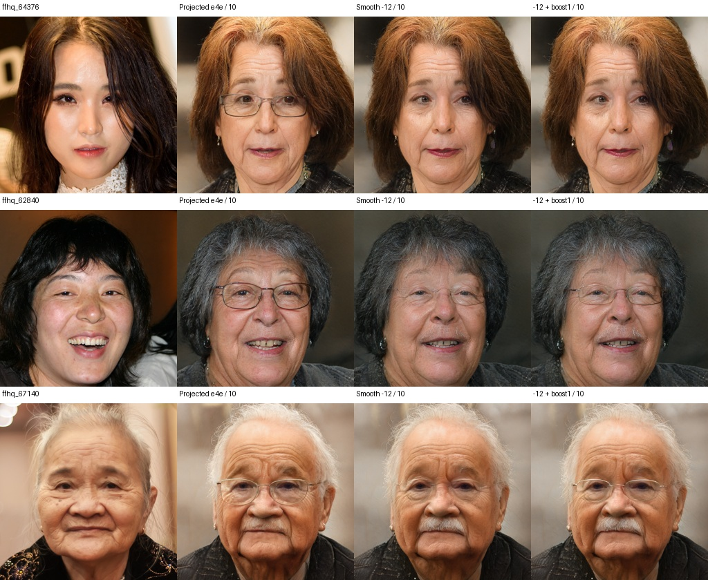
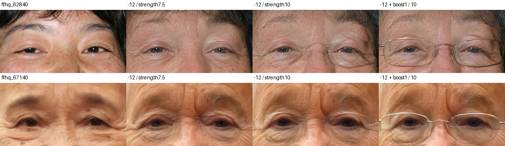

# e4e −12眼镜修正：连续老化与年龄补偿

2026-11-28，研究分支 `dev/mobei-gan-portable-20261116`。用户认可上一项−12相对更稳定地抑制新增眼镜，沿此方向继续。这里记录固定配方、完整开发回归和副作用，不将少量图的成功外推为保证。

## 事前固定设计

沿用官方e4e反演、眼镜边界正交投影后的年龄方向和冻结StyleGAN2，输出原生1024。权重来源、SHA256与[上一项眼镜修正](20261128_e4e高龄眼镜属性控制.md)一致，没有新训练、SFE空间特征注入、SAM差值或图像修脸。

从现有35图开发集取全部29张FFHQ高清参考，保留逐张来源、许可、哈希；不包含该清单的6张APPA图，不使用41张未见储备。此前主要检查的8张包含在29张内，另21张是扩展开发检查，并非独立盲评。10张人工检查原照戴镜，19张未见镜框；这些标签只用于汇总副作用，**不会选择推理路线**。FFHQ可能与预训练集重叠。

人工分组更正：最初小图将65835误记为戴镜，查看原生参考确认实际无镜，已用独立 `manual-label-review.json` 更正；冻结的实验／源码快照和所有推理不回写，评分汇总读取这一更正。该图−12的缩略眼周一度疑似残留镜框，随后检查原生裁图没有清楚可辨的完整镜框，不能把疑似阴影／残影当确定戴镜；保留原图供复核。未来prepare的诊断名单也相应更正。

发布外观年龄档20–29／30–39／40–49／50–69／70+分别为7／4／4／7／7张，发布女性10／男性19；18张有Asian标注，11张该字段未知，不能将未知组称为其他人种。没有新增照片或真实同人跨龄对照。

三路线：原去耦合e4e；随正向老化逐渐启用−12；相同眼镜修正再增加固定最多1单位的老化强度。所有29人都使用三条完整路线和相同固定参数，不逐图搜索或选优。

```text
t = clip(strength / 7.5, 0, 1)
gate = t² × (3 − 2t)
glasses_offset = −12 × gate
effective_strength = strength + optional 1 × gate
w_edit = w_source + effective_strength / 2 × projected_age_direction
                     + glasses_offset × official_eyeglasses_boundary
```

| 选择强度 | 原路线 | 渐进−12：眼镜偏移 | 补偿路线：实际老化强度 |
|---|---:|---:|---:|
| −10／−5／0 | 原强度 | 0 | 原强度 |
| 2.5 | 2.5 | −3.1111 | 2.7593 |
| 5 | 5 | −8.8889 | 5.7407 |
| 7.5 | 7.5 | −12 | 8.5 |
| 10 | 10 | −12 | 11 |

不在年轻化或重建时统一施加−12，防止改变此前结果。平滑门控在0和7.5的导数为0，是连续强度策略；离散7档输出只能检查所采样位置，不等于已验证所有中间帧。补偿1是事前固定的单项假设，不针对MiVOLO分数逐图优化。内部11属于显式外推，需观察是否重新戴镜、过老化或改变身份。**任何强度都不等于具体年龄。**

## 运行与交付

首轮目录 `deployment/training-runs/e4e-schedule-20261128-094340`，任务 `j-1795859047-830199`，申请GPU=1、Replicas=1，最长运行20分钟／等待10分钟。提交前通过平台SDK确认没有其他活跃项目任务；排队持续提示 `insufficient group quota: gpu : 2001/2k`。没有重复申请或结束其他用户进程，随后只停止自己的排队任务，平台已确认Stopped，未执行模型推理。

改用独立CPU任务 `j-1795859366-272238`，目录 `deployment/training-runs/e4e-schedule-cpu-20261128-094856`，GPU=0、8核CPU／32GiB。沿用相同平台镜像、模型与固定配方，仅切换设备。所有本次比较均采用本次CPU基线；不将CPU／GPU可能存在的浮点差异称为逐字节相同。对既有GPU输出事前限定跨设备像素差：最大≤8、平均绝对误差≤.1（8位0–255），实际差异另报；同设备重复前向和≤0保护仍要求逐像素完全一致。

实际完成29×7×3＝609张原始PNG及609张保色PNG，全部1024且可解码。强度≤0的两个候选与本次CPU基线共174项逐字节相同，计为重复控制，不当作额外独立样本；总共435组不同生成配置。复核原始8图的56项投影基线，以及7.5／10档16项−12结果，共72项CPU／GPU比较：最大像素差1，最坏的平均绝对差.000168，均在事前阈值内；不称跨设备逐字节一致。固定参数、噪声和原生参考，无模型参数更新，重复前向与模型前后指纹一致。

CPU worker实际用时767.20秒（约12分47秒），包含模型加载、反演、生成、保色、PNG写入与SFace，不包含排队、容器启动和最终CPU估龄／画廊制作。Python3.10.12、Torch2.6.0+cu124、CUDA库12.4，但实际device为CPU、GPU数0，不能当作GPU推理速度。平台最终Succeeded，首轮排队GPU任务Stopped；`deployment/e4e-schedule-20261128-job-status.json`核对项目active为空。

原生复核发现明确反例：67140在10档的−12去掉了明显眼镜，补偿1后又出现细镜框。因此补偿不是默认改进，保留不加补偿的−12为后续主候选；已按原固定协议生成完整对照，没有删掉失败路线或按图挑补偿。68335去镜收益保留，但帽子丢失等身份细节问题未解决。

扩展回归还发现62840在强度10的−12仍出现细镜框，7.5时不明显；61172、62840、60241的补偿路线也重新出现明显镜桥／镜框。61580发布标注为女性，编辑后新增胡须，眼镜修正没有解决该属性变化。**−12有明确可见收益，但不能由最初8图推断所有人都不新增眼镜；不加补偿也不是整体身份／属性保持达标。**

## 完整评分与选择

下表仅汇总29人×7.5／10两个高龄强度共58个条件，避免把未变的重建／年轻化混入改进均值。独立MiVOLO v2提供外观年龄，SFace提供身份余弦；二者都不是生成照片的真实年龄或人工身份判断。所有58项均能检测到脸。

| 路线 | 高龄SFace↑ | 平均外观年龄 | 相对基线年龄变化 | 身份下降>.02条件数 |
|---|---:|---:|---:|---:|
| 投影e4e | .3973 | 68.35 | 0 | — |
| 渐进−12 | .4357 | 65.53 | −2.82岁 | 13／58 |
| −12加1补偿 | .4085 | 67.62 | −.73岁 | 15／58 |

原照无镜的19人／38个高龄条件：−12的SFace .4007→.4450，平均外观年龄68.35→65.09，7个条件身份下降>.02。原照有镜10人／20条件：.3909→.4180，68.34→66.37，6个条件下降>.02。均值提高不代表每个人都受益，也不能证明镜框细节可靠保留；原本戴镜的63721等出现明显变淡／改变，65817、65714仍保留清楚镜框。

所有正向强度共116个条件中，−12平均身份变化+.0331，但最差−.0977，18项下降>.02；补偿路线最差−.1273、23项下降>.02。0→10平均外观跨度27.05→24.73；按逐人跨度比取均值为91.7%，补偿为97.3%。采样的174个相邻强度对中，原路线有1个外观估龄倒退，两个候选为0；这是7档采样的外观响应，不能外推为所有连续帧都平滑或年龄已校准。

**继续采用“不加年龄补偿的渐进−12”作为研究主候选**，配方单列于 [e4e-minus12-research.json](../models/e4e-minus12-research.json)。它没有通过所有通用替换标准：高龄平均绝对年龄变化2.96岁超过事前2岁限值，新增眼镜与个体身份问题仍在。用户认可的方向被保留，但不以此声称整体属性控制已完成；上传应用默认不变，没有产生新的通用训练权重。



64376：KRWonders，[原照](https://www.flickr.com/photos/koreanwonders/36345325941/)，[CC BY 2.0](https://creativecommons.org/licenses/by/2.0/)；62840：Alessandro Vernet，[原照](https://www.flickr.com/photos/avernet/1805263001/)，[CC BY-NC 2.0](https://creativecommons.org/licenses/by-nc/2.0/)；67140：Lộc Phạm，[原照](https://www.flickr.com/photos/duyloc/26878285989/)，[Public Domain Mark](https://creativecommons.org/publicdomain/mark/1.0/)。图包含缩放和模型年龄编辑，按各自条款用于非商业研究展示。



来源与许可同上，局部裁自原生1024。完整图和全部条件可在网页下载。自动评分结束时的 `visual_review_pending` 仅为评分检查点；人工观察另存在精简证据的 `manual_visual_review`，没有把它改成独立盲评或去镜准确率。

## 在电脑看完整结果

保持已有隧道，打开 [−12连续老化与补偿](http://localhost:16512/age-e4e-no-glasses-review/)。如果尚未开隧道，在电脑运行：

```powershell
ssh -N -o ExitOnForwardFailure=yes -o UpdateHostKeys=no -L 127.0.0.1:16512:127.0.0.1:65512 yicloud
```

页面保留29张照片和全部7档／3路线，可切原始与保色、全脸与原生眼周／脸颊，并下载完整1024 PNG。它是已完成真实模型输出的留档，不需要GPU，不代表即时上传服务在线。图像哈希和PNG验收、独立年龄缓存及浏览器回执随[精简证据](evidence/e4e-minus12-schedule-20261128.json)保存。

Chromium实际验收通过：页面HTTP200，29张照片／7档强度全部切换、原始与保色、原生256局部、下载PNG为1024×1024，390宽无横向溢出、无JS错误。首次验证在画廊索引完成前触发，等待超时；已增加就绪检查，并在1247张预览与局部资产生成完成后重跑通过，不将首次失败当通过。

## 复现入口

```bash
python3 integration/quality/e4e_no_glasses_schedule.py prepare
# 无GPU配额时可改为 prepare --cpu；先确认原排队任务终止，勿并行申请。
# 上一步会打印独立新目录。仅在项目没有其他活跃GPU任务时提交：
python3 integration/quality/e4e_no_glasses_schedule.py submit deployment/training-runs/实际新目录
# DONE后才评分和建立留档：
deployment/asia-adaptation/20261123/age-cpu-venv/bin/python integration/quality/finish_sfe_conditioned.py deployment/training-runs/实际新目录
```

参考图、运行源码、纯Torch算子、模型规格和父输出固定哈希；原始快照在 `source/`、上游在 `upstream/`、worker日志在 `worker.log`。模型和输入资产复用现有目录，不下载新权重或升级共享Torch/CUDA。CPU评分检查独立MiVOLO外观年龄、SFace身份、漏检、完整PNG、零强度／年轻化保护；高龄指标按原照有镜／无镜分别报告。
