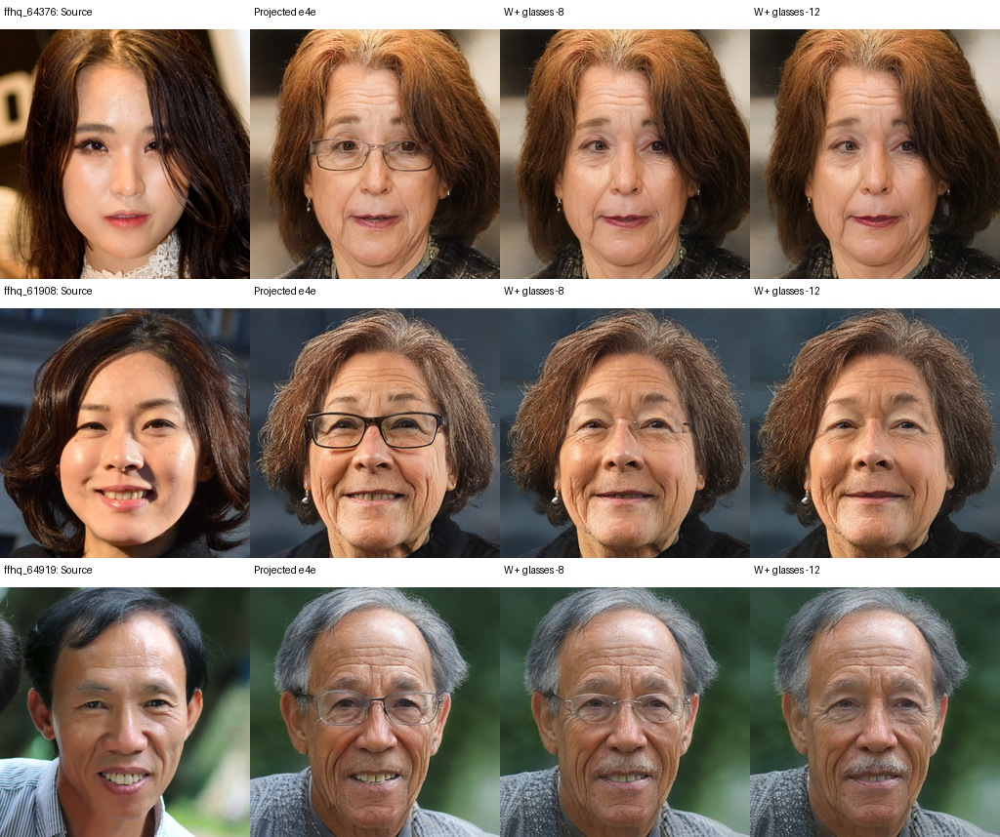
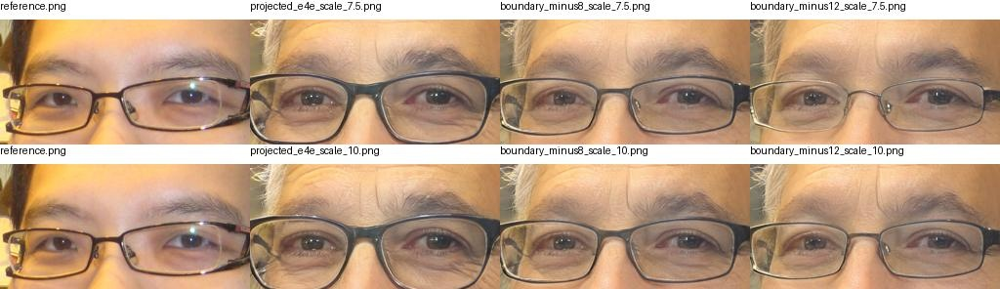

# e4e 高龄新增眼镜：属性保留与负向修正对照

2026-11-28，研究分支 `dev/mobei-gan-portable-20261116`。针对用户观察到的“去耦合 e4e 较自然，但年纪大时自动戴眼镜”，实际完成两项冻结模型推理实验。**固定负向 W+ 眼镜属性修正有清楚可见的去镜收益；保留四个源图 StyleSpace 通道的收益不足。前者仍有镜片残影、年龄感下降和原有镜框改变，尚未得到可靠的自动属性保留方案。** 本轮没有训练，没有替换上传应用或默认权重。

## 直接看结果

自己电脑保持以下 SSH 隧道运行，已有隧道则直接打开网页：

```powershell
ssh -N -o ExitOnForwardFailure=yes -o UpdateHostKeys=no -L 127.0.0.1:16512:127.0.0.1:65512 yicloud
```

- [高龄眼镜修正扫描](http://localhost:16512/age-e4e-glasses-sweep/)：原照、投影 e4e、W+ −4／−8／−12、四通道 −3／−6／−9，所有图使用全部相同设置。
- [原照眼镜通道保留](http://localhost:16512/age-e4e-glasses-review/)：保留0%／50%／100%，包括强度0的重建保护对照。

建议先在修正扫描页比较 `projected_e4e`、`boundary_minus8`、`boundary_minus12`，再切换“原生眼周”和原始／保色。页面支持全部8图、全部条件、完整1024 PNG下载；属于无需GPU的真实推理留档。**7.5／10是编辑强度，不是75／100岁。** 网关仅监听服务器回环地址。

## 问题定位与模型来源

沿用[上一轮官方眼镜边界正交投影](20261128_SFE条件训练与属性解耦.md)：将年龄 W+ 方向减去在眼镜边界上的投影，再恢复原范数。虽然向量已正交，高龄图仍产生眼镜。生成器是非线性映射，线性正交不保证图像里的眼镜语义独立；官方边界和少量语义通道也不是眼镜的完整因果表示。

“训练照片中老年与戴镜相关”是合理解释，**本轮没有重审预训练集的眼镜标注，不能证明它是唯一成因或仅由数据少导致**。大幅编辑离开源脸附近的分布、线性方向的局限都可能参与。增加普通人脸数量不会自动解开属性关联。

本轮实际链路为：1024参考 → 256输入的官方 e4e 反演 → 投影后年龄 W+ 编辑 → 冻结 StyleGAN2 原生1024生成 → 可选原照保色。**没有 SFE 空间特征注入，没有 SAM 年龄差值，没有用同学的 ft_l1 编码器替代 e4e。** 初始化容器仍复用 SFE 的推理封装和三份模型文件，其中 SFE 编辑器未参与本次输出计算。

官方 SFE 代码固定 `00996c309ba5f04eec9ad7456f521e1501f7cc67`，检出保持干净；e4e／StyleGAN2 权重来自官方 AIRI-Institute/StyleFeatureEditor 固定发布，完整SHA256见 `integration/models/sfe-*.json` 和本轮[精简证据](evidence/e4e-glasses-20261128.json)。没有下载新大模型、升级共享环境或更新模型参数。

## 固定开发图与干预

沿用8张已看过的高清开发图：64376、61908、62644、64919、65817、67140、60764、68335。人工目视检查中65817原照戴眼镜，其余7张无眼镜；这只是本轮人工对照标记，**不是部署了自动眼镜分类器**。来源、许可、发布年龄档和文件哈希随 `selection.json` 保存。可能与 FFHQ 预训练重叠，不是独立盲测；41张未见储备没有使用。

第一项在强度0／5／7.5／10，将官方 `get_stylespace_from_w` 输出中四个眼镜卷积通道按50%／100%恢复为源图 e4e 的对应值。官方方向 `(3,288),(2,175),(3,120),(2,97)` 经 `STYLESPACE_IDX` 映射后实际为 `(1,97),(1,175),(2,120),(2,288)`。其余卷积及ToRGB style保持编辑结果。每人都使用同一规则，不按照片挑通道或强度。

第二项在高龄强度7.5／10扫描两种固定修正：

```text
w_edited = w_source + strength / 2 * projected_age_direction
w_corrected = w_edited + offset * official_eyeglasses_boundary
offset ∈ {−4, −8, −12}
```

W+眼镜边界来自官方 `Eyeglasses_boundary.npy`，形状1×9216，重排为1×18×512，范数约1。offset是固定绝对偏移，没有随年龄强度缩放。同时保留四个StyleSpace通道各减3／6／9的失败控制。每张图生成全部路线，不按人搜索最优参数，无图像拼接、修脸或超分。

## 实际观察与独立评分

**源通道保留未解决新增眼镜。** 首批三张无镜源图在强度10仍明显生成镜框；100%保留仅有局部变弱。非零强度24个输出中，100%保留的平均SFace变化 +.0077，平均外观年龄变化 +.02岁，0→10外观跨度比 .9979。数值保护通过不足以说明眼镜问题修复。

**负向 W+ 修正确有收益。** 64376、62644等图的新增镜框明显减轻；61908在−8仍有透明镜片／鼻梁残影，−12更干净；64919、67140在−8仍有清楚镜框，−12才明显去除。60764、68335也观察到去镜收益，但68335的白发、胡须与帽子丢失并未修复。这里是已看过开发图的人工观察，不给出未经独立标注的“去镜准确率”。

65817原照已有眼镜，两个强度下−8／−12输出仍可见镜框，但框形、粗细和对比度受影响；**本轮不能声称原有眼镜被全部删掉，也不能声称已可靠保留**。无条件负向修正存在过度压制原属性的风险，只有一个戴镜对照不足以验证普适性。

下表仅为8人×2个高龄强度共16个条件的均值。身份为独立SFace余弦；外观年龄变化由独立MiVOLO v2计算，相对同图同强度的投影e4e基线，非照片真实年龄。负向修正也可能因减弱眼周老化而提高身份分数，不能将指标改善单独当作自然度证明。

| 固定路线 | SFace↑ | 平均外观年龄变化 | 单项身份下降>.02的条件数 |
|---|---:|---:|---:|
| 投影 e4e | .3875 | 0 | — |
| W+ −4 | .4113 | −.78岁 | 0／16 |
| W+ −8 | .4379 | −1.54岁 | 1／16 |
| W+ −12 | .4434 | −2.76岁 | 2／16 |
| 四通道各−3 | .3831 | −.34岁 | 4／16 |
| 四通道各−6 | .3691 | −.33岁 | 7／16 |
| 四通道各−9 | .3633 | −.24岁 | 8／16 |

−8的平均绝对年龄变化1.71岁，最差身份变化−.0302；−12分别3.03岁／−.0473。四通道负向偏移没有可靠去镜收益，部分图反而让镜框更明显或改变形状，因此不采用。修正扫描没有强度0，不能声称0→10跨度保护通过。原投影e4e在强度10的SFace仅.3507，−8也只有.3887：**视觉自然和跨龄身份保护是两回事，后者仍是明显问题。**



上图为缩略图，完整原生图在网页下载。64376：KRWonders，[原照](https://www.flickr.com/photos/koreanwonders/36345325941/)，[CC BY 2.0](https://creativecommons.org/licenses/by/2.0/)；61908：Sherwood411，[原照](https://www.flickr.com/photos/sherwood411/12394588574/)，[CC BY-NC 2.0](https://creativecommons.org/licenses/by-nc/2.0/)；64919：Mỹ thuật trẻ，[原照](https://www.flickr.com/photos/44328737@N08/37888253166/)，[Public Domain Mark](https://creativecommons.org/publicdomain/mark/1.0/)。包含裁剪、缩放和模型年龄编辑，按各自条款用于非商业研究说明，不代表真实年龄或未来容貌。



65817：Tomasz Dunn，[原照](https://www.flickr.com/photos/tdd/3451732799/)，[CC BY 2.0](https://creativecommons.org/licenses/by/2.0/)。此图是原生眼周裁剪的缩略展示，经过年龄编辑，不是未修改照片。

## 资源、验证与复现

| 运行目录 `deployment/training-runs/` 下 | 平台任务 | 原始／保色各张数 | worker用时 |
|---|---|---:|---:|
| `e4e-glasses-20261128-074348` | `j-1795851887-32604` | 96 | 73.07秒 |
| `e4e-glasses-20261128-074728` | `j-1795852132-988998` | 112 | 91.02秒 |

合计208张原始＋208张保色1024 PNG，包含重复基线，不是208人或独立样本。两项单卡任务先后执行，均Succeeded；状态回执 `deployment/e4e-glasses-20261128-job-status.json` 的active为空。Python3.10.12、Torch2.6.0+cu124、CUDA12.4、H200，每项Torch峰值分配约2.50GiB，不是容器总显存。worker时间包含模型加载、推理、文件写入和SFace，不含排队、容器／独立venv启动和后续CPU估龄；修正的预热后单次生成约.038秒，**不是完整上传请求耗时**。本轮为离线对照，没有声称测得实时API延迟。

两项共48个条件验证了StyleSpace转换后的基线与父运行PNG逐像素相同。源通道实验的零强度三路线也逐像素相同；重复前向与模型前后指纹验证通过。PNG1024解码、SHA256、独立估龄及完整条件数均检查；复用的32／16个基线年龄值先校验父输出SHA256，不冒称新算。Chromium验收两页的全部条件／全部照片切换、保色、原生256局部、1024PNG下载、390宽显示且无JS错误。

推理源码：[e4e_glasses_study.py](e4e_glasses_study.py)；CPU评分／留档：[finish_sfe_conditioned.py](finish_sfe_conditioned.py)；浏览器验收：[verify_sfe_conditioned_browser.py](verify_sfe_conditioned_browser.py)。准备与提交入口如下，**只有复现实验时才执行提交，每次最多一张项目卡，等前一项结束后再提交后一项**：

```bash
python3 integration/quality/e4e_glasses_study.py prepare --method source
python3 integration/quality/e4e_glasses_study.py prepare --method sweep
# 每条prepare打印新目录；用实际新目录替换下行，不要覆盖旧结果。
python3 integration/quality/e4e_glasses_study.py submit deployment/training-runs/实际新目录
# worker完成后，用独立CPU评分环境处理实际运行目录。
deployment/asia-adaptation/20261123/age-cpu-venv/bin/python integration/quality/finish_sfe_conditioned.py deployment/training-runs/实际新目录
```

准备阶段冻结源文件哈希、模型规格、参考图和父输出；各次原始执行脚本在运行目录的 `source/` 留存。Git记录父提交和本轮源码；之后对主脚本说明文字的整理不回写原始快照。

本轮人工复核随精简证据保存；评分脚本的 `visual_review_pending` 是自动评分结束时状态，人工观察另在证据的 `manual_visual_review` 记录，不把自动数值通过当作人工验收。所有条件保留，不晋升。

## 接下来的取舍

e4e自然度仍值得保留，当前有用的候选是“投影年龄方向＋独立眼镜属性控制”，而不是继续无约束放大自由残差。−8可用于显式研究选项，−12只作为更强修正对照；它们不是已验证的新通用权重，也没有接入上传应用。

下一项应先区分“原本有眼镜要保留”和“避免新增长出眼镜”，可以由用户明确选择，或在有足够戴镜／无镜标注与对照后使用可靠原属性判别。再加入年龄、身份、眼周外观与镜框保留的联合约束，覆盖无镜老人／戴镜青年等反相关样例。新增数据要保留这些属性标签，并同时检查高清眼周；不能仅增普通年龄照片就宣称解耦。后续还需处理身份、白发胡须和帽子变化，不能因眼镜减轻便称生成质量彻底解决。
