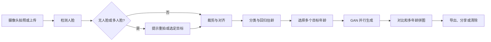

# 基于对抗生成网络的人脸年龄变换系统课堂讨论详细报告

**用途**：课堂讨论、问题陈述、需求初稿和后续方案比较的共同底稿  
**检索日期**：2026 年 10 月 21 日  
**讨论通知**：当天 13:20 开始，教师在讨论过程中参加  
**项目题目**：基于对抗生成网络的人脸年龄变换系统

> 本报告把课程资料、今日讨论要求、同类产品公开资料、论文摘要和作者代码仓库信息整理到同一份材料中。产品部分以开发者官网、应用商店简介或官方文章为依据；论文部分以原始论文页面或 arXiv 摘要为依据。报告没有安装应用、购买会员、上传人脸、下载模型权重、训练模型或进行真实用户测试，因此网页中的“逼真”“秒出图”“最好”等宣传语不会被当作本项目已经达到的性能结论。

## 1 项目基本要求

### 1.1 课程对本项目的要求

课程资料把“基于对抗生成网络的人脸年龄变换系统”列为训练题目之一。需求阶段要求完成三类检索：

| 课程要求 | 最低数量或要求 | 本次准备情况 |
| --- | --- | --- |
| 应用商店或网站中的类似或相近应用 | 至少 5 个 | 整理 6 个代表性应用，并按应用合并官方页面、应用商店简介和补充文章 |
| 商业宣传或产品简介 | 至少 5 篇 | 整理 6 份开发者简介、产品功能页或官方文章；其中与应用资料存在交叉，已在计数说明中明确 |
| 相关论文 | 至少 5 篇 | 整理 9 篇，覆盖年龄估计、人脸检测、条件 GAN、生命周期变换和细粒度年龄控制 |
| 应用功能 | 根据检索结果确定至少 5 项 | 提出 14 项候选功能，其中 12 项建议首版核心、2 项作为补充或待课堂确认，并给出输入、输出和验收方式 |
| 性能指标 | 每人提出，组长平衡总体指标 | 提出可测量的候选指标；数值仍需在确定设备和模型后实测修订 |
| 技术方案 | 每人针对负责功能调研至少 2 个方案，比较并选出最佳方案 | 给出 A-E 各环节的候选方案和课堂需要确认的选型问题 |
| 详细设计 | 要求到功能函数或类 | 已将需求拆成模块边界；函数、类、参数和测试用例需在方案确定后补写 |

课程最终交付包括项目计划书、需求规格说明书、概要和详细设计说明书（含数据库设计）、源代码清单、测试计划与测试报告、用户手册、安装手册、项目总结报告、项目进展周报、小组评分和项目讲评 PPT。课程要求主要文档前后呼应，并在文档中标注每个成员的贡献；课程资料给出的示例是 `<成员姓名>…</成员姓名>`。

课程安排是先了解课题，再进行需求和设计，剩余时间编码并最终答辩；每组 3–4 人，每周不少于 6 学时，每周至少讨论一次。这里的阶段安排是课程总体节奏，不能代替老师另行公布的本组截止日期。

### 1.2 题目分点 A-E 的工程化解释

| 分点 | 题目原意 | 需要实现的可观察结果 | 前后依赖和边界 |
| --- | --- | --- | --- |
| A 获取摄像机图像 | 从摄像机取得输入 | 摄像头预览、拍照、重拍，获得可送入算法的原始 RGB 图像 | 必须有摄像头链路；连续视频实时变龄不是题目明确的最低要求，可作为扩展 |
| B 截取其中的人脸图像 | 从输入图像定位并截取人脸 | 人脸框、关键点或对齐结果、裁剪人脸图像、原图坐标变换 | 无人脸、多人脸、侧脸、遮挡和低清图必须有处理策略；B 必须保存变换信息，E 才能回贴 |
| C 多分类法与回归法相结合识别年龄 | 估计输入人脸的当前年龄 | 年龄类别或年龄概率分布，以及连续年龄值或回归结果 | DEX 的“分类后取期望”与“独立回归分支”不是同一件事；需请教师明确最低口径 |
| D 根据现有年龄和人脸，使用 GAN 生成多年龄目标脸 | 生成同一个人在不同目标年龄的外观 | 每个目标年龄有一张结果图，结果与来源人脸和目标标签对应 | 需明确精确岁数还是年龄段、是否覆盖儿童、源年龄是否作为网络显式条件、是否允许预训练模型 |
| E 图像合成及其他后续处理 | 将结果整理为可查看、可保存的产品输出 | 原图与结果对比、多年龄拼图、可选原图回贴、导出和清除 | “拼图展示”和“把生成脸融合回原照片”是两个不同难度的功能，必须分开验收 |

建议所有目标年龄都从同一张原始人脸开始生成，不要把上一年龄的生成结果继续作为下一年龄的输入，否则会累积模型误差、身份漂移和图像瑕疵。年龄估计结果可以用于用户界面和年龄差计算，但只有在模型接口明确接收源年龄、并经过训练或验证时，才可在技术文档中说“生成网络使用了现有年龄条件”。

### 1.3 两套往年模板对本项目的启发

本次读取了两套压缩包中的主要模板，提炼出以下文档结构：

| 模板来源 | 可直接借鉴的结构 | 本项目的使用方式 |
| --- | --- | --- |
| 《项目文档模板.zip》中的《产品需求规格说明书》 | 文档介绍、产品介绍、用户群体、标准或规范、产品范围、角色、功能需求分类、非功能需求、需求模型和需求确认 | 作为需求规格说明书的主骨架；把 A-E 及 FR 编号放入功能需求表 |
| 《卓业工程综合训练文档模板.zip》中的 ISO《用户需求说明书》 | 同类产品情况、功能性需求、用户界面、软硬件环境、质量属性 | 把本报告的应用对比转为“同类产品情况”，把指标转为质量需求 |
| ISO《概要设计说明书》 | 总体设计、性能、输入输出、处理流程、结构、接口、运行设计、数据结构、错误处理 | 将采集、检测、估龄、生成、合成和导出拆成模块，并画模块关系图 |
| ISO《详细设计说明书》 | 每个模块的描述、功能、性能、输入、输出、算法、流程、接口、存储、限制、测试计划 | 后续每个模块至少写到函数或类、参数、异常和测试用例 |

模板中的旧版软件、操作系统、数据库和硬件描述只是格式参考，不应自动写入本项目技术要求。正式文档需要替换模板占位符，保留真实成员、版本、日期和参考文献。

## 2 今日课堂讨论目标

### 2.1 今日必须拿到的结果

1. 用一段话说明系统服务的用户、要解决的问题、输入、处理链和输出。
2. 从同类应用中提炼至少 5 项有明确输入和输出的功能，而不是只罗列“有一个年龄滤镜”。
3. 明确首版范围：单人还是多人、照片还是视频、绝对年龄还是年龄差、儿童是否必须覆盖、是否必须原图回贴。
4. 对“多分类与回归相结合”形成可向老师确认的技术口径。
5. 确认预训练 GAN 是否允许直接集成，是否要求训练或微调，以及组内能提供的 GPU 和显存。
6. 确认每位成员的功能负责范围、至少两个候选技术方案、下一次讨论前的验证任务。

### 2.2 建议的课堂议程

| 顺序 | 讨论内容 | 现场应记录的结论 |
| --- | --- | --- |
| 1 | 题目和课程交付要求 | 组内统一的项目名称、首版目标和文档清单 |
| 2 | 同类应用对比 | 哪些能力属于共同需求，哪些只作为扩展 |
| 3 | 问题陈述 | 用户、场景、痛点、系统范围和输出 |
| 4 | A-E 技术链 | 每步输入、输出、异常和模块负责人 |
| 5 | 关键技术口径 | 分类与回归、预训练模型、目标年龄、图像合成 |
| 6 | 性能与验收 | 用什么数据、什么设备、什么指标来判断完成 |
| 7 | 分工和下一步 | 每人交付内容、截止时间和需要教师确认的事项 |

### 2.3 建议向教师确认的四个问题

| 问题 | 若答案不同，对项目的影响 |
| --- | --- |
| DEX 的分类概率取期望是否满足“多分类与回归相结合”，还是必须有分类头和独立回归头？ | 决定年龄模型结构、损失函数、训练资料和测试指标 |
| 是否允许使用公开预训练模型完成工程集成，是否必须由小组训练或微调？ | 决定数据集、显卡、训练时间、许可证和最终可运行性 |
| E 中的“图像合成”是指多年龄拼图，还是必须把生成人脸回贴到原始照片？ | 两者对应不同的空间变换、掩膜和融合算法，工作量差别很大 |
| D 的目标是精确输入年龄、年龄区间还是儿童/成年/老年阶段；是否必须覆盖儿童？ | 决定交互控件、模型输入条件、数据分布和可承诺的范围 |

## 3 检索范围、方法和证据等级

### 3.1 检索范围

本次使用了开发者官网、Google Play 开发者简介、Apple 官方 Lookup 接口、产品官方文章、CVF Open Access、arXiv 和作者代码仓库。检索记录保存在[检索记录目录](./检索记录/)，其中包括 URL、最终 URL、HTTP 状态、获取时间、页面标题和提取正文；来源汇总保存在[来源清单](./来源清单.json)。

正式计数为：**6 个应用、6 份商业宣传或简介、9 篇论文**。6 份商业简介分别对应 6 个应用，应用资料与宣传资料存在交叉，这是课程要求中的两种资料类别，不应被误读为 12 个独立产品。

### 3.2 证据等级

| 等级 | 资料类型 | 可以支持的结论 | 不能直接支持的结论 |
| --- | --- | --- | --- |
| A | 论文原始摘要、CVF 页面、arXiv 页面 | 论文提出的问题、方法、作者声称的实验方向和书目信息 | 本组设备上的速度、准确率和可部署性 |
| B | 开发者官网、商店简介、官方产品文章 | 产品公开宣传的功能、输入方式、年龄选择、导出方式、平台和隐私声明 | 产品内部是否使用 GAN、真实效果是否稳定、跨设备性能 |
| C | 作者代码仓库 README | 运行环境、命令、模型输入输出、权重和数据集说明 | 代码在本组环境中一定可运行、结果一定达到论文水平 |
| D | 用户评论或搜索结果 | 只能作为发现问题或候选检索入口 | 产品功能、质量和安全性的正式证据 |

本报告主要使用 A-C 级资料，未把用户评论计入应用能力结论。Apple 商店网页在本次环境中跳转到中国区 Today 页面，所以 Oldify 和 AgingBooth 的简介采用 Apple 官方 Lookup 接口核对；查询结果均返回对应应用的一条记录。部分候选网页返回 404、动态空壳或不相关搜索结果，未计入正式数量。

## 4 同类应用检索结果

### 4.1 选择“重点比较应用”的原则

这里的“最新、最好”采用可核对的工程标准理解：页面有明确的当前更新时间或 2026 年官方文章、功能描述完整、与 A-E 任务相关、能提供可比较的输入/输出信息。没有进行统一设备上的实际安装测试，因此不能声称下表是客观市场排名。课堂上建议把 **YouCam Makeup、Fotor、FaceApp** 作为功能成熟度和交互设计的重点参照，把 **FaceLab、AgingBooth、Oldify** 作为年龄检测、自动裁脸、年龄差和视频扩展的补充参照。

### 4.2 六个应用的完整对比

| 应用与选择理由 | 同一应用的官方链接和本地文档 | 输入与人脸处理 | 年龄控制与变换能力 | 输出、交互与分享 | 隐私、商业和运行限制 | 对本项目的直接启发与局限 |
| --- | --- | --- | --- | --- | --- | --- |
| **FaceApp**  
重点参照：移动端产品成熟、官方商店页显示 2026-10-09 更新，页面公开描述完整 | [官网](https://www.faceapp.com/)；[Google Play 开发者简介](https://play.google.com/store/apps/details?id=io.faceapp&hl=en)；[隐私政策](https://www.faceapp.com/privacy)；[使用条款](https://www.faceapp.com/terms)；[本地页面记录](./检索记录/P11.json) | 以自拍和人像为主；商店简介强调一键滤镜和人像编辑。公开简介未明确说明摄像头实时视频链路、多人脸策略或自动裁脸算法 | 公开列出 Old、Young、Baby 等年龄滤镜；没有从简介中核实任意整数年龄输入，也没有核实其内部年龄估计方法 | 支持每一步的前后对比，支持直接分享到社交平台；另外有发型、胡须、妆容、光效、去痘、磨皮等 60 多种滤镜或工具 | Google Play 显示含应用内购买；页面显示会收集或与第三方分享若干数据类型，传输加密并提供删除请求；存在服务端请求限制和会员门槛的公开反馈，但反馈不作为正式性能证据 | 借鉴“一键处理、前后对比、结果分享、身份可辨认”的产品流程。不能据此推断其采用 GAN，也不能把“photorealistic”当作本项目的验收结论；年龄控制粒度不足以直接满足 D 的多目标精确年龄要求 |
| **YouCam Makeup / 玩美彩妆**  
重点参照：官方 2026 年文章对年龄进程功能给出较完整的步骤和结果格式 | [官方年龄应用文章](https://www.perfectcorp.com/consumer/blog/selfie-editing/best-age-progression-apps)；[官方免费/安全年龄滤镜文章](https://www.perfectcorp.com/consumer/blog/selfie-editing/best-free-safe-aging-app-ios-android)；[YouCam Makeup 产品入口](https://youcamapps.com/surl/SRY)；[本地文章记录](./检索记录/P02b.json)；[本地补充文章记录](./检索记录/M02.json) | 上传自拍或人像；官方文章将年龄检测、年龄变换和人像编辑放在一个流程中。文章未给出底层人脸检测模型和多人脸处理规则 | 文章写明可自动检测当前年龄，并可在 **12–70 岁**之间用滑条选择年龄；同时支持变老和变年轻。该范围是官方文章的产品说明，不是本组实测可用范围 | 可保存单图、前后对比图、网格图和 MP4 视频；文章还强调可查看不同年龄结果、分享和配合妆容/发型功能 | 官方文章给出免费次数和订阅信息，但价格和次数会变化；文章宣称隐私标准，仍应以当前隐私政策为准；未核实本地离线运行 | 与本题最接近的产品参照：当前年龄估计、目标年龄选择、多目标对比和多格式导出都能直接转成需求。需要注意它是厂商自评文章，其他产品的排名和“唯一”等表述不应直接当作独立评测结论 |
| **Fotor AI Age Progression**  
重点参照：网页功能说明清晰，当前页面写明“任意年龄”宣传和多个年龄阶段 | [AI Age Progression 功能页](https://www.fotor.com/features/ai-age-progression/)；[Fotor 应用入口](https://www.fotor.com/app.html)；[本地页面记录](./检索记录/P19.json) | 网页上传或拖拽图像，支持 JPG、JPEG、PNG、HEIF、HEIC、WEBP；页面建议输入图像约 256–4096 px；清晰、单人肖像更适合处理 | 页面操作说明列出 Child、Teenager、Adult、Middle Aged、Elderly；页面同时使用“choose an age”“at any age”等宣传语，但本次没有实际操作验证是否能输入每一个整数年龄 | 生成后下载，页面宣传无水印和 HD 下载；提供男性和女性示例、不同人生阶段示例，以及家庭、亲子、伴侣共同变老等宣传场景 | 网页服务意味着需要上传和网络连接；未从本次页面提取到完整的本地隐私处理保证；“seconds”“HD”“realistic”等是产品宣传语，必须在本组设备上测量 | 借鉴上传格式校验、年龄阶段选择、生成状态、下载和多案例展示。应在需求中把“年龄阶段”和“精确目标岁数”拆开，不能只依据页面宣传把它写成精确连续控制 |
| **FaceLab**  
重点参照：Google Play 页面显示 2026-09-11 更新，公开功能范围多 | [Google Play 开发者简介](https://play.google.com/store/apps/details?id=com.lyrebirdstudio.facelab&hl=en)；[本地页面记录](./检索记录/P12.json) | 公开简介包含年龄相机、未来脸、发型、人脸形状、胡须和性别变换等人像编辑能力；未明确照片/摄像头的每种入口、多人脸策略或检测模型 | 同时宣传 AI Aging、Age Changer 和 Age Scanner；有“变老”和“看起来多大”的不同功能，但没有核实精确目标岁数接口 | 包含无广告和无水印的高级选项，具体订阅限制以当前页面为准；公开简介未明确是否支持多年龄拼图或 MP4 导出 | Google Play 声明不与第三方分享数据，但会收集应用活动、应用信息和设备标识，且页面显示数据不能删除；这属于开发者声明，不是隐私审计 | 适合说明“年龄估计”和“年龄变换”必须分为两个可验收功能，也提醒我们不要把附加的发型、性别、胡须等功能加入首版范围 |
| **AgingBooth**  
重点参照：流程非常明确，适合比较自动裁脸和本地处理思路，但产品页面较旧 | [官网](https://www.piviandco.com/apps/agingbooth/)；[Apple 官方 Lookup 条目](https://itunes.apple.com/lookup?id=357467791&country=us)；[本地官网记录](./检索记录/P05c.json)；[本地 Apple 条目记录](./检索记录/P16.json) | 支持内置摄像头拍照和照片库；商店简介明确写有自动人脸检测裁剪。页面说明适合单人正面照片，具体姿态条件未完整给出 | 主要是即时变老效果，没有核实任意目标年龄、源年龄估计或多年龄批量生成 | 支持前后视图切换、结果图库、保存到照片库，并可通过邮件、短信、Instagram、Snapchat、Facebook、Twitter、WhatsApp 等分享；开发者简介宣称无需联网即可变换 | 官网和商店信息带有 2010–2020 年产品痕迹，当前系统和模型兼容性需要复核；产品明确声明仅供娱乐，不能保证符合真实老化过程；本地运行能力可作为候选而不是既定事实 | 直接启发 A、B、E：摄像头/相册双入口、自动裁脸、前后对比、保存和离线候选。它不满足本题的年龄估计、多目标精确控制和 GAN 工程链，不能作为完整技术方案 |
| **Oldify**  
重点参照：以年龄差和动态视频为特色，补充“目标年龄”交互 | [Apple 官方 Lookup 条目](https://itunes.apple.com/lookup?id=621561671&country=us)；[本地 Apple 条目记录](./检索记录/P15.json) | 通过 iPhone/iPad 摄像头拍照，也支持制作照片和视频；公开简介未说明自动裁脸和多人脸策略 | 支持按“比现在大 10、20、40、60、80 或 99 年”等年龄差变换；这不是“变成 20 岁”的绝对年龄控制。公开简介还提到可改变到某个老年年龄和 20、40、60、80、99 年的年龄差描述，二者应在需求中区分 | 支持老年表情、手势、道具、声音和自定义视频，也支持照片和视频分享；动画是娱乐化扩展，不是本题核心要求 | 需要 Apple 设备或兼容应用环境；页面没有提供本组可用的模型、接口和部署信息；不能把商店宣传的动态效果直接转成实时性能承诺 | 借鉴年龄差控件、视频和动态结果作为扩展；核心设计应明确 `年龄差 = 目标年龄 - 当前年龄`，避免“目标年龄”和“增加年数”混用 |

### 4.3 应用之间的共同点、差异和可借鉴优先级

| 对比维度 | 共同趋势 | 最有代表性的应用 | 对本项目的建议 |
| --- | --- | --- | --- |
| 输入 | 自拍、相册上传是主流，部分支持摄像头 | AgingBooth、Oldify | 题目明确要求摄像机，因此摄像头必须是首版入口；上传作为测试和补充入口 |
| 人脸处理 | 商业产品通常隐藏检测和裁剪细节 | AgingBooth 明确宣传自动裁剪 | 将检测、选脸、裁剪、对齐和原图坐标保存为独立模块，不能依赖生成模型“自己处理” |
| 年龄控制 | 有的使用 Old/Young，有的使用阶段，有的使用年龄滑条，有的使用年龄差 | YouCam Makeup、Fotor、Oldify | 需求中同时写清控制类型：绝对年龄、年龄段或年龄差，首版只选一种主交互 |
| 当前年龄 | 少数产品公开宣传年龄检测 | YouCam Makeup、FaceLab | C 必须独立验收；不要把生成结果的年龄标签当作年龄估计准确率 |
| 多年龄输出 | 对比图、网格图、不同年龄阶段较常见 | YouCam Makeup、Fotor | 一次任务生成多个目标，并以网格或时间轴呈现，适合课堂演示 |
| 合成 | 结果保存和分享普遍，原图回贴未被多数简介明确说明 | FaceApp、AgingBooth | 先完成拼图和对比，再决定是否把脸回贴到原始照片；两者分开写需求 |
| 隐私 | 商店会公开数据收集或删除声明，但产品之间差异大 | FaceApp、FaceLab、AgingBooth | 需求写清临时数据、清除入口、是否联网、是否保留历史，不照搬宣传口号 |
| 商业模式 | 免费次数、广告、订阅、应用内购买很常见 | YouCam、FaceApp、FaceLab | 课程系统可先不做计费；但可以把水印、任务限制和服务端依赖作为竞品分析项 |
| 适用范围 | 娱乐和社交分享是主流定位 | AgingBooth、Oldify | 本项目定位为技术演示和年龄外观模拟，不把输出描述为真实医学或身份预测 |

### 4.4 对本组最有用的产品参照组合

如果课堂要求只重点展示 3 个产品，建议选：

1. **YouCam Makeup**：功能链与本题最完整，覆盖当前年龄检测、目标年龄滑条、多结果比较和多格式导出。
2. **Fotor**：网页端输入和输出说明清楚，适合说明上传格式、阶段选择、生成和下载的工程流程。
3. **FaceApp**：产品成熟度和前后对比设计有代表性，适合说明一键体验、身份可辨认和分享需求。

如果需要再展示 3 个补充案例，则加入 FaceLab（年龄扫描与变龄分离）、AgingBooth（自动裁脸和离线候选）和 Oldify（年龄差与动态视频）。这是基于公开资料完整度和课程相关度的推荐，不是统一实测后的市场排名。

## 5 论文检索结果

### 5.1 论文总表

| 编号 | 文献与链接 | 方法与主要结论 | 对 A-E 的支持 | 使用时的限制或注意点 |
| --- | --- | --- | --- | --- |
| P01 | Rothe, Timofte, Van Gool. **DEX: Deep EXpectation of Apparent Age From a Single Image**. ICCV Workshops, 2015. [CVF 原文页面](https://openaccess.thecvf.com/content_iccv_2015_workshops/w11/html/Rothe_DEX_Deep_EXpectation_ICCV_2015_paper.html)；[本地记录](./检索记录/L01.json) | 将年龄回归转成深度分类，再用 softmax 概率的期望细化连续年龄；论文描述了人脸检测、裁剪和 CNN 预测流程 | C：最直接的“分类结果转连续年龄”基线 | 论文估计的是 apparent age（表观年龄）；使用 20 个网络集成和特定数据，不能直接承诺本组单模型性能；分类后取期望不等于独立回归头 |
| P02 | Pan, Han, Shan, Chen. **Mean-Variance Loss for Deep Age Estimation From a Face**. CVPR, 2018. [CVF 原文页面](https://openaccess.thecvf.com/content_cvpr_2018/html/Pan_Mean-Variance_Loss_for_CVPR_2018_paper.html)；[本地记录](./检索记录/L09.json) | 以年龄分布表示标签不确定性，联合 softmax、预测分布均值与真实年龄的均值损失、预测方差约束；在多个年龄数据库上报告改进 | C：更完整地支持“分类与连续数值结合” | 需要明确真实年龄/表观年龄标签、年龄分布定义和训练数据；论文结果不能直接替代本组测试集 |
| P03 | Zhang, Song, Qi. **Age Progression/Regression by Conditional Adversarial Autoencoder**. CVPR, 2017. [CVF 原文页面](https://openaccess.thecvf.com/content_cvpr_2017/html/Zhang_Age_ProgressionRegression_by_CVPR_2017_paper.html)；[本地记录](./检索记录/L02b.json) | CAAE 把输入脸编码到潜空间，再以年龄条件生成变老或变年轻的脸；强调不要求同一人的年龄配对照片，潜变量保留个体特征 | D：条件年龄生成和身份保持的基础思路 | 模型、数据和图像分辨率较旧；是否直接适合当前 GPU、输入姿态和儿童范围需实测 |
| P04 | Antipov, Baccouche, Dugelay. **Face Aging With Conditional Generative Adversarial Networks**. ICIP, 2017. [arXiv](https://arxiv.org/abs/1702.01983)；[本地记录](./检索记录/L03.json) | 提出 Age-cGAN，并对潜变量做 identity-preserving 优化，利用人脸识别和年龄估计评价变老/变年轻结果 | D：说明身份保持应成为生成目标和评价指标 | 论文仅说明方法和潜力；不能从摘要得到本组模型权重、许可证或部署性能 |
| P05 | Yang, Huang, Wang, Jain. **Learning Face Age Progression: A Pyramid Architecture of GANs**. CVPR, 2018. [CVF 原文页面](https://openaccess.thecvf.com/content_cvpr_2018/html/Yang_Learning_Face_Age_CVPR_2018_paper.html)；[本地记录](./检索记录/L04.json) | 分别建模个体特征和年龄变化，使用多尺度金字塔判别器改善年龄细节和真实感，考虑姿态、表情和妆容变化 | D、E：启发多尺度生成和视觉质量检查 | 论文方法复杂度较高；真实感、身份保持和年龄准确性需要分别评估，不能只看一张示例图 |
| P06 | Or-El 等. **Lifespan Age Transformation Synthesis**. ECCV, 2020. [arXiv](https://arxiv.org/abs/2003.09764)；[作者仓库](https://github.com/royorel/Lifespan_Age_Transformation_Synthesis)；[本地记录](./检索记录/L06.json) | 多域 GAN 建模连续双向年龄过程，使用固定年龄类别作为锚点；同时修改纹理和头部形状，论文展示 0–70 岁的全头部变化 | D、E：适合比较全生命周期、头部形状和纹理变化 | 训练和推理对输入质量、数据集和 GPU 有要求；“0–70 岁”是论文实验范围，不代表本系统必须或能够覆盖该范围 |
| P07 | Alaluf, Patashnik, Cohen-Or. **Only a Matter of Style: Age Transformation Using a Style-Based Regression Model**. ACM TOG/SIGGRAPH, 2021. [arXiv](https://arxiv.org/abs/2102.02754)；[SAM 作者仓库](https://github.com/yuval-alaluf/SAM)；[本地记录](./检索记录/L07b.json) | 把真实人脸编码到预训练 StyleGAN 潜空间，由年龄回归网络引导目标年龄，支持较细粒度的年龄转换；README 给出多个目标年龄推理示例 | D：最适合验证“一张输入、多个数值目标年龄” | 作者仓库说明 NVIDIA GPU、CUDA/cuDNN 和 Python 环境；CPU 并非原生支持；依赖的模型、数据和许可需逐项核对 |
| P08 | Zhang, Zhang, Li, Qiao. **Joint Face Detection and Alignment using Multi-task Cascaded Convolutional Networks**. IEEE SPL, 2016. [arXiv](https://arxiv.org/abs/1604.02878)；[本地记录](./检索记录/L08.json) | MTCNN 用多阶段网络联合检测与对齐，提供人脸框和关键点 | B：人脸截取和对齐候选方案 | 模型对姿态、遮挡和速度的表现要在本组样例上比较；不能只根据论文年份选型 |
| P09 | Deng 等. **RetinaFace: Single-stage Dense Face Localisation in the Wild**. arXiv:1905.00641, 2019. [arXiv](https://arxiv.org/abs/1905.00641)；[本地记录](./检索记录/L10.json) | 单阶段密集人脸定位，目标是复杂环境中的检测和关键点定位 | B：与 MTCNN 比较的现代检测候选 | 论文目标和公开实现不等于本组设备速度；授权、模型大小和部署依赖要另测 |

### 5.2 年龄估计的关键技术判断

DEX 的基本计算可以写成：

```text
p(k | x) = 模型对年龄类别 k 的概率
年龄预测 a_hat = Σ k × p(k | x)
```

它把分类分布转成连续年龄，是对题目“多分类与回归相结合”的一种解释，但它未必满足教师所说的“分类头 + 独立回归头”。Mean-Variance Loss 直接在年龄分布上约束均值和方差，并联合 softmax 损失，更适合作为课堂上讨论“结合方式”的第二方案。

建议至少记录三种结果：

- 预测的连续年龄；
- 年龄段或年龄类别概率；
- 置信度或不确定性说明，且不能把最大类别概率未经校准直接称为真实置信度。

训练和测试必须先区分真实年龄与表观年龄。照片只能反映外观，不能保证恢复真实年龄；产品界面也应把结果描述为年龄外观估计，不应写成身份、健康或医学预测。

### 5.3 年龄生成的方案比较

| 比较项 | SAM | LATS |
| --- | --- | --- |
| 目标控制 | README 展示可直接指定 0、10、20……80 等目标年龄，适合多目标输出 | 以年龄锚点和插值构成生命周期变化，适合展示连续过程 |
| 变化范围 | 细粒度年龄转换，依赖 StyleGAN 潜空间和年龄回归引导 | 论文展示 0–70 岁，纹理和头部形状同时变化 |
| 工程入口 | 作者仓库给出安装、权重和 inference 命令 | 作者仓库提供数据整理、预训练模型和推理/生成流程 |
| 资源限制 | README 明确要求 NVIDIA GPU、CUDA/cuDNN；CPU 不是原生支持 | 训练和生成也有较高资源与输入质量要求，具体环境需要实测 |
| 对本项目的首轮价值 | 优先验证“一个输入、多目标年龄、并排结果” | 作为头形变化和全生命周期能力的对照 |
| 选型前必须做的实验 | 固定 5–10 张合法测试图，生成至少 3 个目标，记录耗时、失败和身份保持 | 同一批图、同一目标年龄、同一评价指标，避免只凭示例图比较 |

建议先验证 SAM 的预训练推理可用性，再用 LATS 做对照；若组内硬件或许可不支持，应退回更轻量的工程路线。这个建议不能替代教师对“允许使用预训练模型”的确认。

## 6 问题陈述与产品范围

### 6.1 课堂可直接采用的问题陈述

面向希望直观体验自身不同年龄外观的普通用户，以及需要展示和评估人脸年龄变换技术的课程演示人员，本项目拟构建一套基于对抗生成网络的人脸年龄变换系统。现有应用能够提供变老、变年轻、年龄阶段选择、前后对比和结果分享，但通常没有把摄像头采集、明确的人脸截取、分类与回归结合的年龄估计、多目标 GAN 生成和图像合成组织成可检查的工程流程。

系统应支持用户通过摄像头获取照片，也可使用符合格式要求的图片作为补充输入；系统自动检测并截取目标人脸，结合多分类和回归方法估计当前年龄；用户选择一个或多个目标年龄后，系统根据同一原始人脸和目标条件生成多个年龄版本；系统提供原图、单目标结果和多年龄拼图的对比展示，并根据最终范围决定是否将结果回贴到原始照片。系统要对无摄像头、权限拒绝、无人脸、多人脸未选择、姿态或清晰度不足、模型超时和保存失败给出可理解的反馈。输出用于年龄外观模拟和技术展示，不作为真实年龄、医学状态或身份判断。

### 6.2 主要用户

| 用户 | 目标 | 需要的功能 |
| --- | --- | --- |
| 普通体验用户 | 查看自己在多个年龄阶段的外观 | 拍照、选脸、估龄、选目标年龄、查看和导出 |
| 课堂演示人员 | 展示完整技术链和不同输入下的效果 | 多目标批量生成、流程状态、对比、异常演示、指标展示 |
| 开发和维护人员 | 更换模型、复现实验、定位失败原因 | 模型版本、任务日志、耗时拆分、错误码和配置 |

### 6.3 建议首版范围

首版优先完成“单人照片、拍照后处理、多个目标年龄、结果对比和导出”的闭环。上传图片作为补充输入，便于测试。多人同时变龄、连续视频实时变龄、社交社区、会员计费、复杂美颜和发型/性别变换均作为扩展候选。若教师明确要求连续视频或全图回贴，再把相应模块提升为首版要求。

## 7 预设功能与需求表

下面的 FR 编号可直接用于需求规格说明书、概要设计和测试计划。P0 是建议首版核心，P1 是补充功能或依赖课堂决策。

| 编号 | 优先级 | 功能名称 | 输入 | 处理与输出 | 验收条件 |
| --- | --- | --- | --- | --- | --- |
| FR01 | P0 | 摄像头预览与拍照 | 摄像头权限、摄像头帧 | 预览画面、拍照原图、重拍入口 | 有设备且授权时可以预览和取得图像；权限拒绝时给出原因和重试入口 |
| FR02 | P1 | 图片上传与格式校验 | JPG、JPEG、PNG、HEIF、HEIC、WEBP 等约定格式 | 方向校正、尺寸检查、统一 RGB 输入 | 合法图像进入同一流程；损坏、超限和不支持格式被拒绝 |
| FR03 | P0 | 人脸检测 | 原图 | 人脸框、关键点、检测置信度 | 单人样本检测成功；无人脸不进入生成；多人脸要求用户点选或明确拒绝 |
| FR04 | P0 | 人脸裁剪与对齐 | 原图、人脸框、关键点 | 标准尺寸人脸图、原图到人脸图的变换参数 | 输出可直接送入年龄模型和生成模型；保留逆变换所需参数 |
| FR05 | P0 | 输入质量检查 | 人脸图、姿态和清晰度信息 | 正面程度、遮挡、模糊和尺寸提示 | 低清、严重侧脸或遮挡时提示重拍或降低结果可信度 |
| FR06 | P0 | 当前年龄估计 | 对齐人脸图 | 连续年龄、年龄类别/分布、估计状态 | 报告中明确分类与回归方案；输出与测试标签定义一致；失败时不伪造年龄 |
| FR07 | P0 | 目标年龄选择 | 当前年龄、目标年龄或年龄段 | 一个或多个目标年龄列表 | 绝对年龄和年龄差有清晰标签；目标不在模型范围时提示；至少支持课堂约定的目标数量 |
| FR08 | P0 | 多目标 GAN 生成 | 原始对齐人脸、当前年龄信息、目标列表、模型版本 | 每个目标一张年龄脸、目标标签和任务状态 | 每张结果都来自同一原图；目标标签不混淆；单个目标失败不覆盖其他成功结果 |
| FR09 | P0 | 原图/结果对比 | 原图、生成结果 | 单图前后对比、滑动对比或并排对比 | 用户能区分原图、源年龄和目标年龄；不出现错配 |
| FR10 | P0 | 多年龄拼图 | 原图和多个目标结果 | 带年龄标签的网格图或时间轴 | 图像顺序正确，标签可读，输出尺寸统一；生成失败位置有占位状态 |
| FR11 | P1 | 原图回贴与融合 | 原图、人脸逆变换、生成结果、掩膜 | 生成脸回贴后的合成图 | 仅在教师确认后纳入首版；测试接缝、色差、背景误改和头发/头形变化 |
| FR12 | P0 | 导出与分享 | 单图、拼图、合成图 | PNG/JPEG 等文件、可选 MP4 扩展 | 导出文件可重新打开且与当前任务一致；保存失败有提示；分享不绕过用户确认 |
| FR13 | P0 | 任务状态与重试 | 任务 ID、各阶段状态 | 等待、处理中、成功、部分失败、失败、错误信息 | 处理中不重复提交；重试不会混入旧任务结果；每阶段有可定位错误 |
| FR14 | P0 | 临时数据清除 | 原图、生成图、任务记录 | 删除本次任务数据和缓存引用 | 清除后应用入口无法再次访问临时数据；用户主动导出的副本另行说明 |

### 7.1 推荐用户流程



## 8 非功能需求和候选性能指标

以下数字是候选目标，不能写成已经达到的结果。确定运行设备、模型、输入尺寸和预热方式后，组长应统一修订。

| 指标 | 候选目标 | 测量方法与注意事项 |
| --- | --- | --- |
| 摄像头预览 | 720p 预览有效帧率约 20 FPS，拍照反馈不超过 1 秒 | 固定设备连续运行 60 秒；预览帧率与后续 GAN 生成耗时分开记录 |
| 人脸检测 | 清晰正面单人样本有效检测率至少 95% | 至少 100 张带框样本；IoU 阈值、负样本误检和多人脸情况另记 |
| 年龄估计 | 首轮可将 MAE ≤ 5 岁作为待验证目标，同时报告年龄段误差 | 使用人物划分的独立测试集；明确真实年龄或表观年龄；按年龄段分层报告 |
| 单目标生成 | 指定 GPU 预热后 P95 ≤ 10 秒作为初测目标 | 至少 30 次；记录预处理、排队、模型推理、后处理和冷启动，不只统计最快成功样本 |
| 多目标端到端 | 4 个目标从提交到结果可查看 P95 ≤ 45 秒作为初测目标 | 包括检测、估龄、生成、合成和任务调度；同时报告超时和失败率 |
| 目标年龄控制 | 报告生成图重新估龄与目标年龄的误差、年龄段命中和变化趋势 | 使用独立或经过校准的评估模型，并补充盲评，不能只用生成模型自己的约束打分 |
| 身份保持 | 报告人脸特征相似度分布和盲评“是否同一人”比例 | 用同人/异人样本校准阈值；不直接套用未经验证的固定阈值 |
| 图像质量 | 记录畸变、接缝、边缘残留和背景误改比例 | 固定样本、固定目标年龄和统一标注规则；小样本人工检查不能包装成完整 FID 结论 |
| 异常处理 | 约定异常用例全部有反馈，应用不崩溃 | 覆盖权限拒绝、无摄像头、无人脸、多人脸、损坏图、超限图、模型超时和保存失败 |
| 数据清除 | 清除后临时原图和生成结果不再从任务入口访问 | 检查临时目录、任务表、缓存和日志引用；用户导出的文件单独说明 |

必须记录测试条件：操作系统、CPU/GPU、显存、模型和权重版本、输入/输出分辨率、样本数量、是否预热、是否联网以及是否并行生成。网页产品的“seconds”“HD”“photorealistic”只能作为比较维度，不能作为本组实测数据。

## 9 技术方案调研起点

课程要求每个人为自己负责的功能至少比较两个方案。下面是可直接分工的方案矩阵。

| 环节 | 方案一 | 方案二 | 比较项 | 当前建议 |
| --- | --- | --- | --- | --- |
| A 摄像头采集 | 浏览器 `getUserMedia` | 本地 OpenCV `VideoCapture` | 权限、部署方式、预览帧率、图片接口、跨平台 | 若做网页演示，优先浏览器；若先做算法原型，优先本地 OpenCV；两者统一输出 RGB 图像接口。浏览器权限规则可参考 [MDN](https://developer.mozilla.org/en-US/docs/Web/API/MediaDevices/getUserMedia) |
| B 人脸检测 | MTCNN | RetinaFace | 正面/侧面、遮挡、关键点、速度、模型大小、依赖和许可 | 先用同一批样本比较召回、误检和耗时，再决定；MTCNN 适合快速验证，RetinaFace 作为复杂场景候选 |
| C 年龄估计 | DEX 分类概率取期望 | Mean-Variance Loss 或分类头+回归头 | 是否满足老师口径、标签类型、训练难度、MAE、年龄分布和不确定性 | 课堂优先向老师确认；若要求严格结合，优先研究 Mean-Variance 或联合双头方案 |
| D 年龄生成 | SAM | LATS | 目标年龄控制、身份保持、头形变化、输入姿态、分辨率、显存、权重和许可 | 先验证 SAM 多目标推理，再用 LATS 比较生命周期和头形效果；不运行就不承诺结果 |
| E 图像合成 | 逆变换+软掩膜羽化 | 泊松融合 `seamlessClone` 或分割后融合 | 接缝、颜色、边界、背景误改、头发和头形变化 | 先完成拼图；若必须回贴，再对同一批图比较两种融合，不能只用一张示例图 |
| 临时数据 | 进程内任务对象和临时文件 | 轻量数据库保存任务、结果和模型版本 | 是否需要历史记录、并发、清除、复现实验和安装复杂度 | 课程演示可先用任务对象+临时目录；若需要历史记录，再补数据库设计 |

### 9.1 建议的模块边界

后续概要和详细设计可采用以下模块：

1. `CameraInput`：摄像头权限、预览、拍照和重拍。
2. `ImageValidator`：格式、方向、尺寸、颜色空间和清晰度检查。
3. `FaceDetector`：检测、关键点、选脸和无人脸/多人脸处理。
4. `FaceAligner`：裁剪、标准化、逆变换参数保存。
5. `AgeEstimator`：分类分布、连续年龄、估计状态和指标记录。
6. `TargetAgePlanner`：绝对年龄/年龄差转换、目标范围校验和任务列表。
7. `AgeGenerator`：模型加载、单目标推理、多目标调度、模型版本和失败状态。
8. `ImageComposer`：原图对比、网格图、可选回贴和颜色/边缘处理。
9. `ExportManager`：PNG/JPEG/MP4 扩展、文件命名、导出和清除。
10. `TaskController`：任务 ID、状态机、日志、超时、重试和错误码。

每个模块都应有明确输入、输出和异常，不应把所有工作写进一个“处理图片”函数。详细设计至少应写到函数或类、参数类型、返回值、异常、算法步骤和单元测试输入。

## 10 主要风险和应对

| 风险 | 表现 | 应对 |
| --- | --- | --- |
| 目标年龄口径不清 | 用户输入“65 岁”却被实现成“增加 65 年” | 交互中明确“目标年龄”或“增加年数”；需求、接口和测试统一一种主口径 |
| 源年龄与目标年龄混淆 | 年龄估计只是显示，模型却被描述成使用源年龄条件 | 在模型接口中列出真实输入；若只用图像+目标年龄，报告中如实说明 |
| 分类与回归要求不清 | DEX 取期望被误写成独立回归网络 | 向教师确认；同时准备 DEX 和 Mean-Variance/双头两个方案 |
| 模型无法在本机运行 | CUDA、显存、权重或 Python 依赖不兼容 | 先做环境和预训练推理验证，再承诺模型；保留轻量回退方案 |
| 身份漂移 | 变老后不像本人，尤其是大年龄跨度或侧脸 | 固定同一原图多目标；加入身份相似度和盲评；限制输入姿态和年龄范围 |
| 头形/头发与脸部不一致 | 小脸贴回原图出现边缘或形状错误 | 拼图与回贴分开验收；需要时扩大合成区域或加入分割；不把小块贴图称作完整合成 |
| 训练数据和标签问题 | 真实年龄与表观年龄混用、同人泄漏、儿童样本不足 | 写明标签类型、人物划分、年龄分层和数据许可；首版范围与数据范围一致 |
| 隐私和授权 | 上传人脸、保留结果、使用公开数据集存在风险 | 明确临时数据和清除；只使用获准样例；逐项核对模型、权重和数据集许可 |
| 把宣传当实测 | 直接写“秒出图”“准确率高” | 用固定设备、样本和指标测量；在报告中区分宣传、论文结果和本组实测 |

## 11 建议的组内分工和近期任务

若为 4 人小组，可按模块划分：成员一负责 A/B 与输入质量；成员二负责 C 与年龄估计评测；成员三负责 D 与生成模型验证；成员四负责 E、界面、任务控制和系统集成。组长负责统一 FR 编号、性能指标、文档版本和对外口径。若为 3 人小组，可将采集与合成集成，但仍保留估龄和生成两个独立责任人。

下一次讨论前的最小任务：

1. 确定演示设备、GPU、显存、操作系统和 Python/CUDA 环境。
2. 让负责 B 的成员用同一批合法样例比较 MTCNN 和 RetinaFace 的检测、关键点和速度。
3. 让负责 C 的成员写出 DEX 与 Mean-Variance/双头回归的输入、输出、损失和测试指标对比。
4. 让负责 D 的成员核对 SAM/LATS 的权重、许可证、依赖和最小推理命令，不必立即训练。
5. 让负责 E 的成员准备一批原图、裁剪图和生成结果，比较拼图与回贴分别需要哪些数据。
6. 组长把课堂决定写回需求规格说明书，并建立“需求编号 → 设计模块 → 函数/类 → 测试用例”的追踪表。

## 12 课堂结论记录区

以下内容应在课堂讨论过程中现场填写，不能由检索资料代替：

| 决策项 | 课堂结论 | 责任人 | 日期 |
| --- | --- | --- | --- |
| 首版输入：摄像头、上传、视频 | 待讨论 | 待填写 | 待填写 |
| 多人脸处理 | 待讨论 | 待填写 | 待填写 |
| 分类与回归的实现口径 | 待教师确认 | 待填写 | 待填写 |
| 预训练模型、训练或微调 | 待教师确认 | 待填写 | 待填写 |
| 目标年龄：绝对年龄、年龄段或年龄差 | 待讨论 | 待填写 | 待填写 |
| 儿童目标是否必做 | 待讨论 | 待填写 | 待填写 |
| 图像合成是否包含原图回贴 | 待教师确认 | 待填写 | 待填写 |
| 演示设备和性能指标 | 待讨论 | 待填写 | 待填写 |
| 组员和模块负责人 | 待讨论 | 待填写 | 待填写 |

本表的“待填写”是课堂记录位置，不是检索缺失，也不应直接作为最终需求书的占位内容提交。

## 13 来源与本地记录索引

### 13.1 课程文件

- [Projects.pdf](../../Projects.pdf)：题目、检索数量、技术调研、文档与最终交付要求。
- [requirements_on_2026_10_21.txt](../../requirements_on_2026_10_21.txt)：当天讨论安排和“查找类似网站或应用、总结需求要点、完成问题陈述”的课堂任务。
- [whole_tasks.txt](../../whole_tasks.txt)：A 获取摄像机图像、B 截取人脸、C 分类与回归结合识别年龄、D GAN 生成多年龄脸、E 图像合成及后续处理。
- [项目文档模板.zip](../../项目文档模板.zip)：需求、概要、体系结构、数据库、模块、测试等模板目录。
- [卓业工程综合训练文档模板.zip](../../卓业工程综合训练文档模板.zip)：ISO/RUP 模板、用户需求、概要设计、详细设计、项目计划等资料。

### 13.2 应用和商业资料

| 产品 | 官方/产品链接 | 本地检索记录 |
| --- | --- | --- |
| FaceApp | [官网](https://www.faceapp.com/)、[Google Play](https://play.google.com/store/apps/details?id=io.faceapp&hl=en)、[隐私政策](https://www.faceapp.com/privacy)、[使用条款](https://www.faceapp.com/terms) | [P11.json](./检索记录/P11.json) |
| YouCam Makeup | [官方年龄应用文章](https://www.perfectcorp.com/consumer/blog/selfie-editing/best-age-progression-apps)、[官方安全年龄滤镜文章](https://www.perfectcorp.com/consumer/blog/selfie-editing/best-free-safe-aging-app-ios-android)、[产品入口](https://youcamapps.com/surl/SRY) | [P02b.json](./检索记录/P02b.json)、[M02.json](./检索记录/M02.json) |
| Fotor | [AI Age Progression](https://www.fotor.com/features/ai-age-progression/)、[应用入口](https://www.fotor.com/app.html) | [P19.json](./检索记录/P19.json) |
| FaceLab | [Google Play](https://play.google.com/store/apps/details?id=com.lyrebirdstudio.facelab&hl=en) | [P12.json](./检索记录/P12.json) |
| AgingBooth | [官网](https://www.piviandco.com/apps/agingbooth/)、[Apple Lookup](https://itunes.apple.com/lookup?id=357467791&country=us) | [P05c.json](./检索记录/P05c.json)、[P16.json](./检索记录/P16.json) |
| Oldify | [Apple Lookup](https://itunes.apple.com/lookup?id=621561671&country=us) | [P15.json](./检索记录/P15.json) |

### 13.3 论文和作者代码

- [DEX](https://openaccess.thecvf.com/content_iccv_2015_workshops/w11/html/Rothe_DEX_Deep_EXpectation_ICCV_2015_paper.html)；本地记录 [L01.json](./检索记录/L01.json)。
- [Mean-Variance Loss](https://openaccess.thecvf.com/content_cvpr_2018/html/Pan_Mean-Variance_Loss_for_CVPR_2018_paper.html)；本地记录 [L09.json](./检索记录/L09.json)。
- [CAAE](https://openaccess.thecvf.com/content_cvpr_2017/html/Zhang_Age_ProgressionRegression_by_CVPR_2017_paper.html)；本地记录 [L02b.json](./检索记录/L02b.json)。
- [Age-cGAN](https://arxiv.org/abs/1702.01983)；本地记录 [L03.json](./检索记录/L03.json)。
- [Pyramid GAN](https://openaccess.thecvf.com/content_cvpr_2018/html/Yang_Learning_Face_Age_CVPR_2018_paper.html)；本地记录 [L04.json](./检索记录/L04.json)。
- [LATS 论文](https://arxiv.org/abs/2003.09764)；[LATS 作者仓库](https://github.com/royorel/Lifespan_Age_Transformation_Synthesis)；本地记录 [L06.json](./检索记录/L06.json)。
- [SAM 论文](https://arxiv.org/abs/2102.02754)；[SAM 作者仓库](https://github.com/yuval-alaluf/SAM)；本地记录 [L07b.json](./检索记录/L07b.json)。
- [MTCNN](https://arxiv.org/abs/1604.02878)；本地记录 [L08.json](./检索记录/L08.json)。
- [RetinaFace](https://arxiv.org/abs/1905.00641)；本地记录 [L10.json](./检索记录/L10.json)。

本报告的应用数量、商业简介数量、论文数量和原始输入文件哈希可在[来源清单](./来源清单.json)中核对。正式引用时应以检索日期和访问日期为准，并在后续版本中记录课堂讨论对范围和指标的修改。
